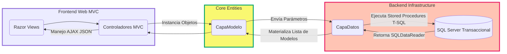

<!-- HEADERS & BANNER ANIMADOS -->
<div align="center">
  

  <h1 style="font-family: 'Inter', sans-serif; font-size: 3.5rem; font-weight: 900; background: -webkit-linear-gradient(45deg, #FF6B6B, #4ECDC4); -webkit-background-clip: text; -webkit-text-fill-color: transparent;">SISTEMA DE VENTAS WEB (ERP-POS)</h1>

  <p style="font-family: 'Inter', sans-serif; font-size: 1.25rem; color: #4b5563; max-width: 900px; line-height: 1.8; margin-top: 15px;">
    <strong>SISTEMA DE VENTAS WEB</strong> no es un simple punto de venta. Es un ecosistema completo de <em>Gestión Empresarial</em>, desarrollado bajo los más altos estándares de calidad de la industria del software. Diseñado para ofrecer <strong>escalabilidad horizontal, seguridad transaccional infalible, y una Experiencia de Usuario (UX) deslumbrante</strong> de última generación.
  </p>

  <br>

  <!-- PROJECT STATUS BADGES (Dinámicos) -->
  <a href="#"></a>
  <a href="#"></a>
  <a href="#"></a>
  <a href="#"></a>

  <br><br>

  <!-- TECH STACK BADGES -->
  <a href="https://dotnet.microsoft.com/"></a>
  <a href="https://docs.microsoft.com/en-us/dotnet/csharp/"></a>
  <a href="https://dotnet.microsoft.com/apps/aspnet/mvc"></a>
  <a href="https://www.microsoft.com/en-us/sql-server"></a>
  <a href="https://getbootstrap.com/docs/4.6/"></a>

  <br>
  

</div>

---

<!-- TYPING ANIMATION (MÁS ATRACTIVA) -->
<div align="center">
  
</div>

<details open>
<summary style="font-size: 1.6em; font-weight: bold; cursor: pointer; color: #4ECDC4; border-bottom: 2px solid #4ECDC4; padding-bottom: 5px; display: inline-block;">&#x1f4da; Navegación Interactiva del Proyecto</summary>

<br>

- [✨ Características Transversales (UX/UI)](#-características-transversales-uxui)
- [🧩 Módulos del Core de Negocio](#-módulos-del-core-de-negocio)
- [🏗️ Arquitectura de Referencia (N-Capas Real)](#️-arquitectura-de-referencia-n-capas-real)
- [💻 Demostración Técnica (Código Limpio)](#-demostración-técnica-código-limpio)
- [🛠️ Stack Tecnológico Completo](#️-stack-tecnológico-completo)
- [🚀 Despliegue en Entorno Local (Guía Paso a Paso)](#-despliegue-en-entorno-local-guía-paso-a-paso)
- [🗺️ Hoja de Ruta (Roadmap)](#️-hoja-de-ruta-roadmap)
- [👨‍💻 ADN del Arquitecto Cloud/Software](#-adn-del-arquitecto-cloudsoftware)

</details>

<br>

<br>

<h2 id="-características-transversales-uxui">✨ Características Transversales (UX/UI)</h2>

La Interfaz de Usuario no se conformó con *templates* genéricos. Se ha sobrecargado con diseño CSS moderno y avanzado para capturar la atención de cualquier operador a la primera impresión:

- 💎 **Glassmorphism Inteligente:** Barras de navegación con propiedades `backdrop-filter: blur(20px)` y `saturate()`, dándole al dashboard un look contemporáneo estilo macOS/Windows 11.
- 🎨 **Tipografía Inter Premium:** Uso exclusivo de Google Fonts *Inter* para máxima legibilidad contable.
- ⚡ **Micro-Animaciones Dinámicas:** Botones con *box-shadows* dinámicos, botones _toggler_ con giro orgánico, layouts que escalan, y menús _dropdowns_ suaves libres de "saltos".
- 📱 **100% Mobile-First:** El sistema operativo ERP no colapsa en móviles; las DataTables son *responsive* asegurando auditorías rápidas desde una Tablet.

<div align="center">
  <!-- PLACEHOLDER RECOMENDADO PARA GIF -->
  
  <br>*(Vista Ilustrativa: Interfaz de Usuario Altamente Funcional).*
</div>


<br>

<br>

<h2 id="-módulos-del-core-de-negocio">🧩 Módulos del Core de Negocio</h2>

Desarrollados con *Clean Code* bajo lógica S.O.L.I.D orientada al servicio REST y JSON.

<table>
  <tr>
    <td align="center"><h3>🔐<br>Sistema de Seguridad Avanzado</h3></td>
    <td>Autenticación robusta. Hasheo criptográfico en base de datos. Modificación de menús en <b>Tiempo Real</b> dependiendo del Rol y Permisos de Base de Datos.</td>
  </tr>
  <tr>
    <td align="center"><h3>💳<br>Motor de Ventas de Alta Demanda</h3></td>
    <td>Carrito de ventas construido íntegramente en JavaScript con peticiones AJAX, optimizando al servidor. Integración directa de Tickets en formato PDF y control de quiebre de <i>Stock</i> online.</td>
  </tr>
  <tr>
    <td align="center"><h3>🏬<br>Inventario Mutli-Almacén</h3></td>
    <td>La plataforma permite gestionar no solo uno, sino múltiples Tiendas y Sucursales simultáneamente. Cálculo matemático automático de utilidades (Precio Compra - Precio Venta).</td>
  </tr>
  <tr>
    <td align="center"><h3>📊<br>Inteligencia de Negocios (BI)</h3></td>
    <td>Un motor de inteligencia para reportes. Filtra transacciones entre fechas complejas y exporta matrices enteras directamente a Excel conservando los estilos.</td>
  </tr>
  <tr>
    <td align="center"><h3>📦<br>Abastecimiento Inteligente</h3></td>
    <td>Flujo contable riguroso: Solo ingresa mercadería cuando se adjuntan detalles con costos fijos de un Proveedor acreditado.</td>
  </tr>
</table>

<br>

<br>

<h2 id="️-arquitectura-de-referencia-n-capas-real">🏗️ Arquitectura de Referencia (N-Capas Real)</h2>

El software implementa un modelo estructural de **Tres Capas Avanzadas**, garantizando que el diseño del Dominio y el Acceso a Datos permanezcan completamente agnósticos respecto a la vista Web (MVC).



> [!TIP]
> 💡 **Arquitectura Tolerante a Fallos:** Toda la lógica pesada transaccional se ejecuta a través de Stored Procedures en SQL, evitando intercepciones (DDoS Layer 7 o Inyección SQL). El controlador solo retorna cadenas JSON y el Motor jQuery DataTables arma la tabla del lado del cliente, permitiendo a la web correr con recursos de CPU mínimos en Producción.

<br>

<h2 id="-demostración-técnica-código-limpio">💻 Demostración Técnica (Código Limpio)</h2>

<details>
<summary><b>🔥 Click aquí para ver un ejemplo de Inserción Transaccional en C#</b></summary>
<br>

```csharp
// Snippet desde: CapaDatos/CD_Venta.cs
// Obsérvese cómo el acceso se hace mediante System.Data.SqlClient con manejo de bloque USING para liberar memoria de RAM automáticamente al finalizar con Garbage Collector.
using (SqlConnection oconexion = new SqlConnection(Conexion.CN))
{
    SqlCommand cmd = new SqlCommand("usp_RegistrarVenta", oconexion);
    cmd.Parameters.AddWithValue("IdUsuario", IDUsuario);
    cmd.Parameters.AddWithValue("IdTienda", IdTienda);
    cmd.Parameters.AddWithValue("DetalleVenta", DetalleVenta); // Se envía XML del carrito entero (Alta Performance)
    cmd.Parameters.Add("Resultado", SqlDbType.Bit).Direction = ParameterDirection.Output;
    cmd.CommandType = CommandType.StoredProcedure;
    
    oconexion.Open();
    cmd.ExecuteNonQuery();
    
    respuesta = Convert.ToBoolean(cmd.Parameters["Resultado"].Value);
}
```
</details>

<br>

<br>


<h2 id="️-stack-tecnológico-completo">🛠️ Stack Tecnológico Completo</h2>

Este repositorio combina el poder de C# con tecnologías probadas en producción masiva.

<div align="center">
  <h3>Backend & Core Logic</h3>
  
</div>

<div align="center">
  <h3>Frontend & Styling</h3>
  
</div>


<br>

<br>

<h2 id="-despliegue-en-entorno-local-guía-paso-a-paso">🚀 Despliegue en Entorno Local (Guía Paso a Paso)</h2>

Sigue escrupulosamente estos pasos para evitar conflictos y asegurar el aprovisionamiento local correcto:

> [!CAUTION]
> 🔥 **Importante:** Tu máquina local debe tener Visual Studio IDE (2019, 2022 o posterior), motor de Bases de Datos `Microsoft SQL Server Management Studio` instalado.


### 1. Modelado de Base de Datos Base 💾
* Abre `SQL Server Management Studio`.
* Ejecuta los Querys/Scripts nativos que se encuentran adjuntos en los repositorios de Backup para restaurar la base `TiendaHe` y crear las tablas Maestras/S-Ps.

### 2. Clonación 🛸
Descarga en tu terminal:
```bash
git clone https://github.com/hectorpalaciosromero/SistemaDeVentasWeb.git
cd SistemaDeVentasWeb
```

### 3. Ajuste Crítico del AppSettings (Web.Config) ⚙️
Abre el archivo `VentasWeb.sln` con Visual Studio. Abre `VentasWeb/Web.config` y localiza el *ConnectionString*. Debes reemplazar `<TU_SQL_SERVER_PC>` con el nombre de tu servidor local.
```xml
<connectionStrings>
  <add name="miconexion" connectionString="Data Source=<TU_SQL_SERVER_PC>;Initial Catalog=TiendaHe;Integrated Security=True"/>
</connectionStrings>
```

### 4. Compilación Completa 🔥
* En el panel derecho de Visual Studio, haz clic derecho en la "Solución" y selecciona `Restaurar Paquetes NuGet`.
* Pulsa el botón superior **IIS Express** (Play), o usa <kbd>F5</kbd>. El explorador lanzará el sistema.

<br>

<br>

<h2 id="️-hoja-de-ruta-roadmap">🗺️ Hoja de Ruta (Roadmap)</h2>

- [x] Arquitectura Inicial N-Capas
- [x] Control de Multitiendas + CRUDs avanzados
- [x] Sistema de Roles + Permisos
- [x] Exportación Dinámica Excel y PDF Tickets
- [ ] Implementación O-Auth2.0 para Logins Tokenizados (API)
- [ ] Refactorización de Capa de Vista utilizando `React` o `Angular` consumiendo `ASP.NET Core Web API`
- [ ] Dockerización y Deploy contínuo en `Azure App Services`

<br>

<br>

<h2 id="-adn-del-arquitecto-cloudsoftware">👨‍💻 ADN del Arquitecto Cloud/Software</h2>

<div align="center">

<table style="width: 100%; border-collapse: collapse; border-radius: 20px; box-shadow: 0 10px 30px rgba(0,0,0,0.1); overflow: hidden;">
  <tr style="background-color: #f8f9fa;">
    <td width="35%" align="center" style="padding: 25px; border-right: 2px solid #e5e7eb;">
      
      <br>
      <h3 style="margin-top: 15px; font-family: 'Inter', sans-serif; font-size: 1.5rem; color: #1f2937;">Héctor Palacios R.</h3>
      <span style="font-size: 0.95rem; font-weight: 600; color: #4ECDC4; background-color: rgba(78,205,196,0.1); padding: 5px 15px; border-radius: 20px;">Full Stack Engineer</span>
    </td>
    <td width="65%" style="padding: 30px; font-family: 'Inter', sans-serif;">
      <h4 style="color: #6366f1; border-bottom: 2px solid #e0e7ff; padding-bottom: 8px; margin-top: 0;">🚀 Dominio Principal (Core Stack)</h4>
      <ul style="color: #4b5563; font-size: 1.05rem; line-height: 1.7; margin-bottom: 25px;">
        <li><b>Backend & APIs:</b> C# / ASP.NET MVC / Web API</li>
        <li><b>Bases de Datos Relacionales:</b> SQL Server, MySQL, T-SQL (Stored Procedures)</li>
        <li><b>Arquitectura Base:</b> Patrones N-Capas, Principios SOLID & Clean Code</li>
      </ul>
        <h4 style="color: #ec4899; border-bottom: 2px solid #fce7f3; padding-bottom: 8px;">🌱 Entornos de Trabajo & Familiaridad</h4>
      <ul style="color: #4b5563; font-size: 1.05rem; line-height: 1.7; margin-bottom: 0;">
        <li><b>NoSQL:</b> MongoDB (Diseño de Documentos)</li>
        <li><b>Ecosistema Web:</b> Node.js / React / Angular</li>
        <li><b>Gestión Ágil de Proyectos:</b> Scrum, Kanban (Jira, Trello)</li>
      </ul>
    </td>
  </tr>
</table>

<br>

<h3 style="font-family: 'Inter', sans-serif; font-size: 2rem; font-weight: 800;">Héctor Palacios Romero</h3>
<p style="font-size: 1.1rem; color: #6b7280; font-weight: 500;">Software Engineer | Full Stack Architect</p>

> _"Escribir código que la máquina entienda es fácil. Escribir código que otros humanos entiendan es el verdadero arte de la ingeniería."_

[](https://github.com/hectorpalaciosromero)
[](https://www.linkedin.com/in/hectorpalaciosromero/)

<br>
<hr style="border-top: dotted 1px;" />


<p><b>Diseñado y Desarrollado con ❤️ en Lima, Perú.</b><br>© 2026 - Derechos de Arquitectura Reservados.</p>

</div>
